<div align="center">
  
</div>

<div align="center">
  <a href="https://github.com/pgwiz">
    
  </a>
</div>

<br>

<table align="center" border="0">
<tr>
<td align="center" valign="middle">
<a href="https://github.com/pgwiz"></a><br /><br />
<a href="https://github.com/pgwiz?tab=followers"></a><br /><br />
<a href="https://github.com/pgwiz"></a>
</td>
<td align="center" valign="middle">

</td>
</tr>
</table>

---

<br>

## [ SYSTEM ARCHITECTURE ]

```typescript
// Assembling production-grade systems, line by line
const system = await architect("Peter Brian Gwadenya")
  .foundation({ os: "Linux", containers: "Docker", cloud: "Multi-Cloud Consoles" })
  .engine({ systems: "Rust", web: "PHP / Modern LAMP", logic: "TypeScript" })
  .mindset("The best error message is the one that never shows up")
  .deploy({ resilience: "zero-downtime", scalability: "production-grade" });
```

<br>

<div align="center">
  
</div>

<br>

<div align="center">
  
</div>

<br>

## [ PERFORMANCE METRICS ]

<div align="center">

<br>

<br>

</div>

<br>

## [ CONNECT & COLLABORATE ]

<table align="center" border="0">
<tr>
<td align="center" valign="middle">

</td>
<td align="center" valign="middle">
<a href="https://contact.pgwiz.cloud"></a><br /><br />
<a href="https://pgwiz.cloud"></a><br /><br />
<a href="https://linkedin.com/in/pgwiz"></a>
</td>
</tr>
</table>

<br>

---

<div align="center">

### [ SYSTEM STATUS: ONLINE ]

**"Building tomorrow's solutions with today's code"**


</div>